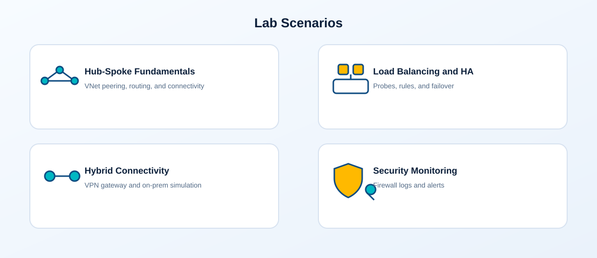
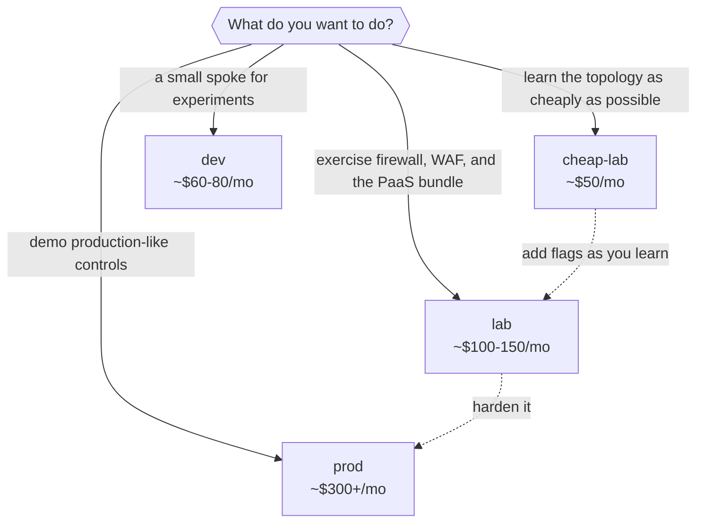

# Environment profiles

<p align="center">
  
</p>

Four tracked profiles in `environments/` deploy the same topology at different
sizes and costs. Each maps to its own GitHub environment, OIDC subject, and
state key, so you can run them side by side. This page compares them so you
can pick one without reading every tfvars file.

## Which profile should I pick?



All estimates are lab planning numbers, not pricing guarantees. Azure Firewall
and VPN Gateway dominate any bill they appear on.

## Feature matrix

Profiles only pin the flags they change. Anything unset falls back to the
defaults in `variables.tf`, which lean feature-rich (Application Gateway,
NAT Gateway, PaaS bundle, and governance all default to on).

| Flag | Root default | `cheap-lab` | `lab` | `dev` | `prod` |
|---|---|---|---|---|---|
| `deploy_firewall` | `true` | `false` | `true` | `false` | `true` |
| `deploy_vpn_gateway` | `false` | `false` | `false` | inherits `false` | `true` |
| `deploy_onprem_simulation` | `false` | `false` | `false` | `false` | `true` |
| `deploy_application_gateway` | `true` | `false` | `true` | inherits `true` | inherits `true` (WAF `Prevention`) |
| `deploy_nat_gateway` | `true` | `false` | `true` | inherits `true`* | inherits `true` |
| `deploy_load_balancer` | `true` | `false` | `true` | inherits `true`* | inherits `true` |
| `deploy_workload_prod` | `true` | `true` | `true` | `false` | `true` |
| `deploy_workload_dev` | `false` | `false` | `true` | `true` | `false` |
| `deploy_aks` | `false` | `false` | `false` | `true`* | `true` (2 nodes) |
| `deploy_container_apps` | `false` | `false` | `true` | inherits `false` | inherits `false` |
| PaaS bundle (`deploy_functions`, `deploy_static_web_app`, `deploy_logic_apps`, `deploy_event_grid`, `deploy_service_bus`, `deploy_app_service`, `deploy_cosmos_db`) | `true` | `false` | `true` | inherits `true`* | inherits `true` |
| `deploy_keyvault` / `deploy_storage` | `true` | `true` | `true` | inherits `true` | inherits `true` |
| `deploy_sql` | `true` | `false` | `true` | inherits `true` | inherits `true` |
| `deploy_private_endpoints` + DNS zones | `true` | `true` | `true` | inherits `true` | `true` |
| `deploy_secondary_dc` | `false` | `false` | `false` | `false` | `true` |
| `deploy_log_analytics` | `true` | `true` | `true` | inherits `true` | inherits `true` |
| `enable_vnet_flow_logs` / traffic analytics | `true` | `false` | `false` | inherits `true` | inherits `true` |
| `deploy_backup` | `true` | `false` | `false` | inherits `true` | inherits `true` |
| Governance (`deploy_azure_policy`, `deploy_management_groups`, `deploy_rbac_custom_roles`, `deploy_regulatory_compliance`) | `true` | `false` | `true` | inherits `true` | inherits `true` |
| `enable_auto_shutdown` | `true` | `true` | `true` | `true` | `false` |
| `enable_vm_encryption_at_host` | `false` | inherits `false` | inherits `false` | inherits `false` | `true` |
| `log_daily_quota_gb` / `log_retention_days` | `1` / `30` | `0.5` / `30` | `2` / `30` | `0.5` / `30` | `5` / `30` |
| Region | – | `westus2` | `westus2` | `West Europe` | `West Europe` |

\* AKS, the load balancer, Container Apps, and the PaaS bundle are wired into
the **prod workload spoke**. The `dev` profile sets
`deploy_workload_prod = false`, so those flags have no effect there even when
they are `true` — the dev spoke only creates the VNet, subnets, NSGs, and
optional route tables.

## Profile summaries

### cheap-lab — topology on a budget (~$50/month)

Everything expensive is explicitly off: no firewall, VPN, Application
Gateway, NAT Gateway, load balancer, SQL, PaaS bundle, or governance
deployments. You still get the full hub-and-spoke fabric, one workload spoke,
Key Vault, Storage, private endpoints, Log Analytics, cost budgets, and
auto-shutdown. Turn individual flags on as your learning progresses.

### lab — the full-featured default (~$100–150/month)

The profile CI plans against. Adds Azure Firewall, Application Gateway (WAF
Detection), NAT Gateway, public load balancer with IIS VMs, both workload
spokes, the complete PaaS bundle, Container Apps, and the whole governance
layer. VPN and on-premises simulation stay off.

### dev — one small spoke (~$60–80/month)

A deliberately minimal experiment space: no firewall or VPN, only the dev
workload spoke. Note the inheritance caveat above — most PaaS toggles are
inert because the prod spoke is disabled. Inherited defaults still deploy
Application Gateway, flow logs, backup, and governance; set those to `false`
if you want a truly minimal footprint.

### prod — production-like lab (~$300+/month)

Demonstrates hardened settings while staying disposable: firewall plus VPN
gateway with simulated on-premises site, WAF in Prevention mode, AKS with two
nodes, secondary domain controller, encryption at host, no public jumpbox IP,
auto-shutdown disabled, and a 5 GB/day log quota. It is still a lab — SKUs
remain small and nothing here is a production guarantee.

## How profiles are applied

```powershell
# Local runs: copy a profile over terraform.tfvars
Copy-Item environments/cheap-lab.tfvars terraform.tfvars

# Pipeline runs: the workflow passes the profile directly
terraform plan "-var-file=environments/lab.tfvars"
```

Each profile maps to a GitHub environment (`cheap-lab`, `lab`, `dev`, `prod`)
plus a matching `-destroy` environment; see the
[pipeline reference](pipeline.md) and
[GitHub setup guide](../../.github/SETUP.md).

## Related pages

- [Variables reference](variables.md)
- [Configuration flow](../architecture/configuration-flow.md)
- [Current config (westus2 lab profile)](current-config.md)
- [Lab testing guide](../testing/lab-testing-guide.md)
