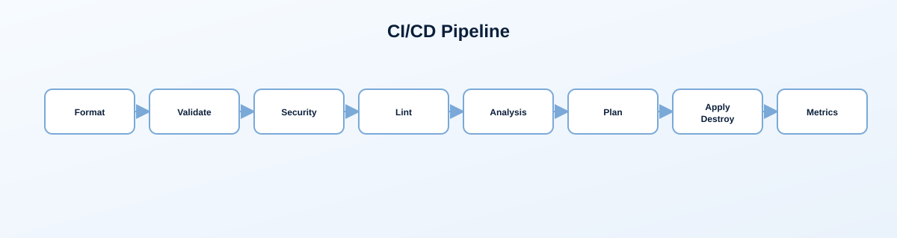
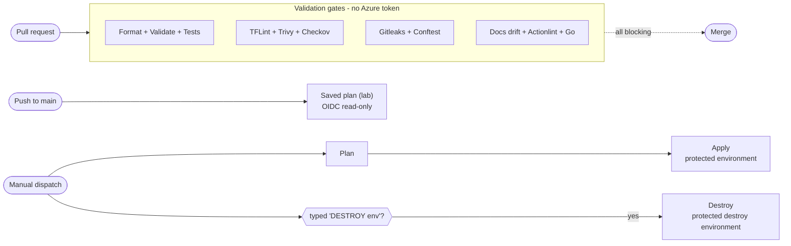

# Pipeline reference

<p align="center">
  
</p>

The `Terraform Pipeline` workflow separates untrusted pull-request validation
from authenticated Azure planning and manual deployment.



## Pull-request gates

| Check | Behavior |
|---|---|
| Format | Terraform canonical formatting |
| Validate | Backend-free initialization with the committed lock file |
| Terraform Tests | Mock-provider regression tests |
| TFLint | Zero-warning Terraform and AzureRM lint baseline |
| Trivy | Medium, High, and Critical IaC findings, with scoped exceptions |
| Checkov | Independent Terraform security policy gate |
| Gitleaks | Full-history credential scan |
| Policy Checks | Conftest secure/insecure fixtures |
| Docs | Generated Terraform references must be current |
| Actionlint | Workflow and composite-action validation |
| Go Tests | Integration-test compilation; live tests skip without Azure inputs |

Pull-request jobs have read-only repository permissions and receive no Azure
OIDC token. Trivy and Checkov alone receive `security-events: write` for SARIF.
The optional Infracost job alone receives `pull-requests: write`.

## Authenticated jobs

- A protected `main` push or manual dispatch may create a saved plan.
- Plan, apply, and destroy alone receive `id-token: write`.
- Apply and destroy are manual dispatch actions.
- Apply downloads the saved plan from the same run.
- Destroy requires `DESTROY <environment>` and a protected destroy environment.
- State is synchronously backed up and verified before either mutation.

External actions are pinned to complete commit SHAs. Terraform provider packages
are cached by lock-file hash and remain checksum-verified by
`.terraform.lock.hcl` using `-lockfile=readonly`.

## Environment and OIDC mapping

Authenticated jobs use one of these environment subjects:

```text
repo:OWNER/REPOSITORY:environment:cheap-lab
repo:OWNER/REPOSITORY:environment:lab
repo:OWNER/REPOSITORY:environment:dev
repo:OWNER/REPOSITORY:environment:prod
repo:OWNER/REPOSITORY:environment:cheap-lab-destroy
repo:OWNER/REPOSITORY:environment:lab-destroy
repo:OWNER/REPOSITORY:environment:dev-destroy
repo:OWNER/REPOSITORY:environment:prod-destroy
```

See [GitHub Actions and state setup](../../.github/SETUP.md) for the complete
bootstrap and recovery procedure.
